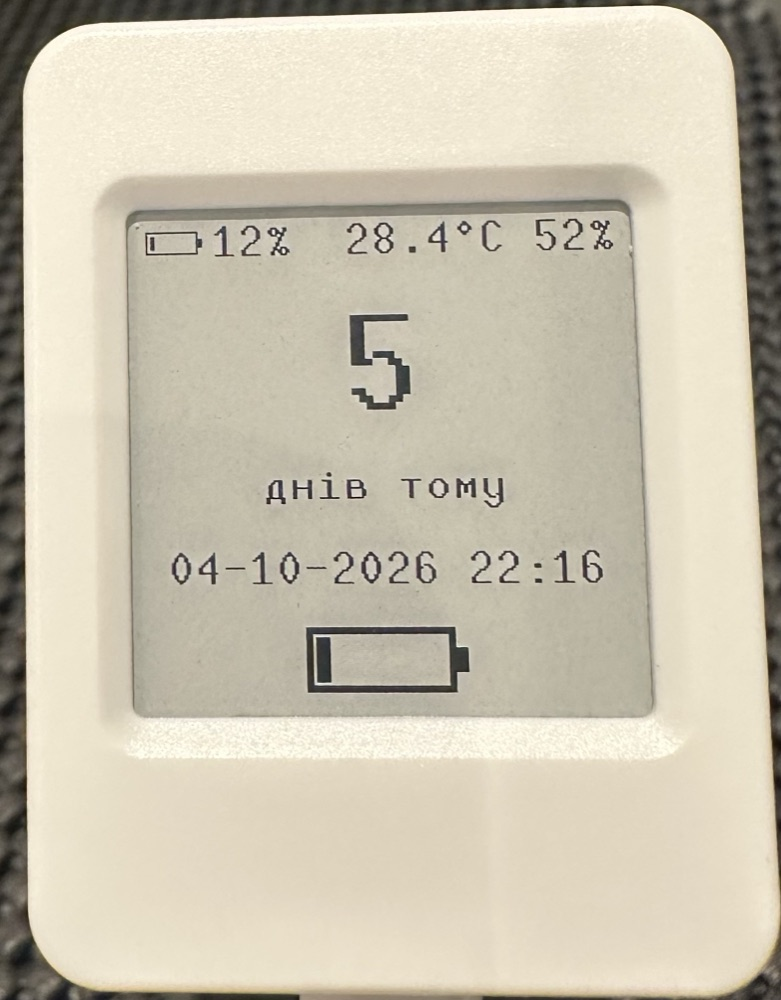
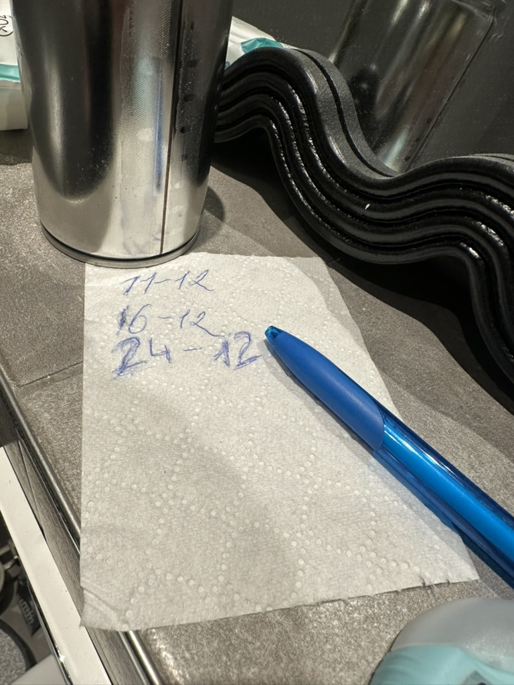
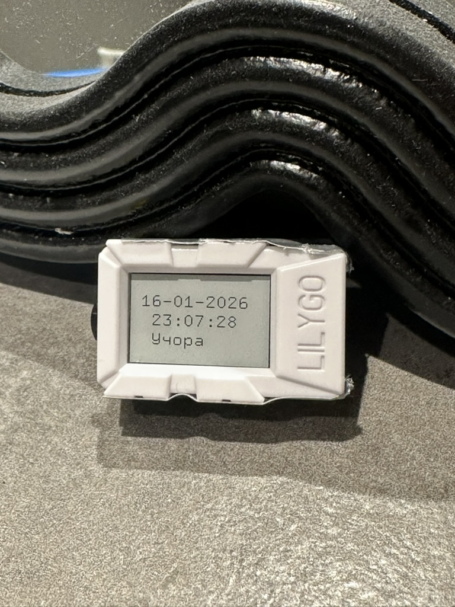
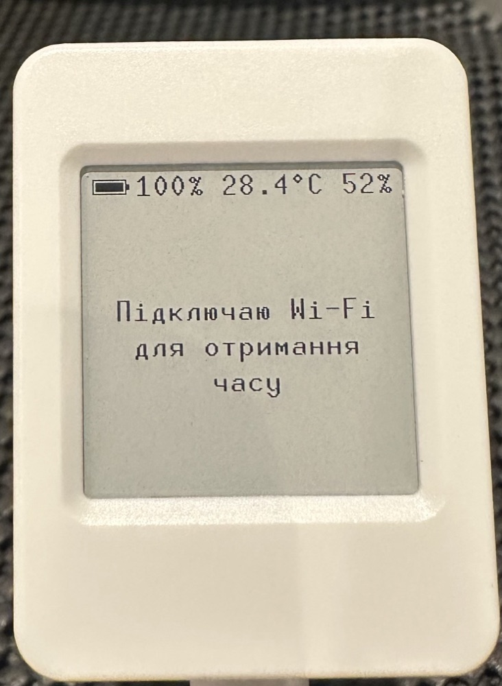

| Supported Targets | ESP32-S3 |
| ----------------- | -------- |

# Toilet Timer

A battery-powered cat litter box change tracker built on the Waveshare ESP32-S3-ePaper-1.54 board.



## Why?



We completely change the cat's litter box about once a week (with regular cleaning in between). The problem was we could never remember when the last change was. We used to write the date on toilet paper with a pen, but then you'd have to check your phone to figure out how many days ago that was.

This device shows how many days have passed since the last change ("Today", "Yesterday", "12 days ago", etc.) together with the date and time of that change, and refreshes itself every night. Press the PWR key to mark a change and reset the counter to "Today".

There's no power outlet in the bathroom, so it needed to be battery-powered. Hence the e-ink display + deep sleep combination.

The first version ran on a LilyGo Mini E-Paper S3 with a tiny 80x128 panel:



## Screens

| Days since the last change | First boot |
|----------------------------|------------|
|  |  |
| Status bar: battery, temperature, humidity. Big day counter with the Ukrainian plural ("5 днів тому"), date and time of the change. The large battery icon at the bottom appears only when the battery is low (the number shrinks to make room). | Shown until the first Wi-Fi time sync; afterwards the time comes from the RTC chip and Wi-Fi is only used occasionally. |

Other variants: "Сьогодні" (today) and "Учора" (yesterday) in large type, and the current date/time alone when no change has been recorded yet. A demo that cycles through all of them can be enabled with `CONFIG_SCREEN_DEMO`.

## Features

- 1.54" e-paper display (200x200) - retains the image with zero power
- Deep sleep between wake-ups for long battery life
- A short press of either key (PWR or BOOT) marks a litter change and resets the counter; the green LED blinks for 5 s
- Holding either key for about two seconds forces a Wi-Fi time sync and OTA firmware check without resetting the counter; the green LED lights once for a second
- Low battery (20 % by default): the green LED blinks fast for 10 s on every wake-up and a large battery icon appears at the bottom of the screen
- Crystal-driven PCF85063 RTC keeps the time between syncs and wakes the device at 1:00 AM for the nightly refresh (the ESP32 sleep timer only serves as a fallback)
- Wi-Fi is used only when needed: on the BOOT key, on the first boot, or when the last sync is older than `CONFIG_TIME_SYNC_INTERVAL_DAYS` (30 by default); summer/winter time switches without any sync, because the RTC stores UTC and the device applies the POSIX timezone rule
- Status bar with the battery level (open-circuit-voltage estimate, meaningful on battery) and the bathroom temperature/humidity from the onboard SHTC3 sensor
- Shows days elapsed since the last change in Ukrainian

## Hardware Required

* [Waveshare ESP32-S3-ePaper-1.54](https://www.waveshare.com/esp32-s3-epaper-1.54.htm), V2 revision (ESP32-S3-PICO-1-N8R8: 8 MB flash, 8 MB PSRAM)
  - 1.54" 200x200 black/white e-paper (SSD1681 controller)
  - PCF85063 RTC, SHTC3 temperature/humidity sensor, lithium battery charger
  - PWR and BOOT keys, USB-C for programming and charging
* 3.7 V lithium battery with an MX1.25 plug (included with some SKUs)
* USB-C cable

> The V1 revision (ESP32-S3FH4R2, 4 MB flash / 2 MB quad PSRAM) has the same pinout but needs
> `CONFIG_ESPTOOLPY_FLASHSIZE_4MB`, `CONFIG_SPIRAM_MODE_QUAD` and a smaller partition table.

## Project Structure

```
toilet-timer/
├── main/
│   ├── main.c                  # Main application logic and Wi-Fi policy
│   ├── global_constants.h      # Font metrics, layout and wake-up constants
│   ├── global_event_group.h    # FreeRTOS event group definitions
│   ├── Kconfig.projbuild       # Board pins and feature options (idf.py menuconfig)
│   ├── battery_level/          # Battery voltage measurement (ADC + divider)
│   ├── board_i2c/              # Shared I2C bus (RTC, SHTC3)
│   ├── board_power/            # Battery power latch and deep-sleep pin holds
│   ├── deep_sleep/             # Deep sleep wake-up sources (keys, RTC alarm, timer)
│   ├── display_epaper/         # E-paper display driver and graphics
│   │   ├── driver/             # Low-level SSD1681 driver
│   │   └── fonts/              # 10x20 bitmap font and its generator
│   ├── nvs_utils/              # Non-volatile storage utilities
│   ├── ota_update/             # Over-the-air firmware updates
│   ├── rtc_pcf85063/           # RTC chip: time restore/save and daily alarm
│   ├── show_messages/          # Screen layout and rendering
│   ├── shtc3/                  # Temperature / humidity sensor
│   ├── sntp/                   # SNTP sync and the "is a sync due" policy
│   ├── system_state/           # System state management (debug helper)
│   ├── time_utils/             # Time and date utilities
│   ├── trigger/                # Reset-timer key handling and text formatting
│   └── wifi/                   # Wi-Fi connection management
├── local_ota_server/           # Local OTA update server files
├── set_manual_timestamp/       # Script to write the last-change date into NVS
├── partitions.csv              # 8 MB partition table (factory + two OTA slots)
├── sdkconfig.defaults          # Board-specific build defaults
├── README.md
└── CMakeLists.txt              # Project build configuration
```

## Setup and Build

### 1. Install ESP-IDF

Follow the [ESP-IDF Getting Started Guide](https://docs.espressif.com/projects/esp-idf/en/latest/esp32s3/get-started/index.html) to install the ESP-IDF development framework (v5.5 or newer).

### 2. Set the Target Chip

```bash
idf.py set-target esp32s3
```

The board-specific settings (flash size, octal PSRAM, partition table) come from `sdkconfig.defaults`.

### 3. Configure Wi-Fi and Timezone

```bash
idf.py menuconfig
```

Set the SSID and password under *TOILET TIMER WI-FI SETTINGS* and the POSIX timezone under *TOILET TIMER SNTP TIME SETTINGS*. If the text appears sideways in your enclosure, change *Display rotation* under *TOILET TIMER E-PAPER DISPLAY SETTINGS*.

### 4. Build the Project

```bash
idf.py build
```

### 5. Flash and Monitor

Connect the board via USB-C and run:

```bash
idf.py flash monitor
```

To exit the serial monitor, press `Ctrl+]`.

If the board does not show up, hold BOOT while plugging it in (or while pressing PWR on battery) to enter download mode.

## Using the Device

| Gesture (PWR or BOOT key) | Action |
|---------------------------|--------|
| Short press | Marks a litter change: the counter resets to "Сьогодні" (today), the date/time is stored, the green LED blinks for 5 s. |
| Hold about 2 s | Wakes up, connects to Wi-Fi, syncs the time and checks for a firmware update. The counter is not touched; the green LED lights for 1 s. |
| PWR on a switched-off board | Hold to switch the board on (battery only). |

The red LED is wired to the charger chip's status pin only (lit while charging) and cannot be controlled by the firmware. The battery percentage is an open-circuit-voltage estimate calibrated with `CONFIG_BATTERY_FULL_MV` (the voltage measured on a full battery, 4060 mV by default).

The firmware never switches the board off; it sleeps with the battery latch held, waking at 1:00 AM to refresh the day counter. Deep-sleep current is dominated by the board's regulators, not by the firmware.

### Time Sync Strategy

- The PCF85063 RTC is the clock. It is read on every boot (a few milliseconds) and written after every successful SNTP sync. It is backed by the battery, so it keeps running even if the board is switched off with the PWR key.
- Wi-Fi costs far more energy than anything else the device does, so it connects only when the BOOT key is pressed, when the time is unknown (first boot), or when the last sync is older than `CONFIG_TIME_SYNC_INTERVAL_DAYS` (checked on every wake-up, including the nightly one). The same session performs the OTA check.
- Summer/winter time does not need a sync: the RTC holds UTC and the timezone rule converts it, including the nightly 1:00 AM alarm.

## Pin Configuration (Waveshare ESP32-S3-ePaper-1.54)

| Function           | GPIO | Description |
|--------------------|------|-------------|
| EPD MOSI (SDI)     | 13   | SPI data out |
| EPD CLK            | 12   | SPI clock |
| EPD CS             | 11   | Chip select |
| EPD DC             | 10   | Data/Command |
| EPD RST            | 9    | Reset |
| EPD BUSY           | 8    | Busy status (HIGH while busy) |
| EPD POWER          | 6    | Panel supply switch, active LOW |
| BAT_Control        | 17   | Battery power latch, HIGH keeps the board powered (held through deep sleep) |
| PWR key (BAT_KEY)  | 18   | Wake-up; short press = mark change, long press = sync (active LOW) |
| BOOT key           | 0    | Same as the PWR key (active LOW) |
| Green LED          | 3    | Key-press feedback (active LOW) |
| RTC INT            | 5    | PCF85063 alarm output, wakes the device at 1:00 AM (active LOW) |
| I2C SDA / SCL      | 47 / 48 | PCF85063 RTC (0x51), SHTC3 (0x70) |
| BAT_ADC            | 4    | Battery voltage / 2 (200K + 200K divider) |
| Audio power enable | 42   | Kept LOW (codec powered in its 0 µA reset state): the ES8311 shares the I2C bus and clamps it when unpowered |

All pins can be changed with `idf.py menuconfig`.

## Local OTA Update

1. Generate a certificate for the OTA Updates. Please **don't forget to fill the server name** on this step:

   **Common Name (e.g. server FQDN or YOUR name) []: 192.168.50.111** (your local IP address).

   `openssl req -newkey rsa:2048 -new -nodes -x509 -days 365 -keyout local_ota_server/key.pem -out main/ota_update/cert.pem -subj "/CN=192.168.50.111"`

2. Create new GIT Tag

   `git tag -a v0.0.1 -m "new release"`

   `git push origin v0.0.1` (optional)

3. Run OTA web-server from `local_ota_server` folder. I'm using this [http-server](https://github.com/http-party/http-server) as **OpenSSL one didn't work properly** and was hanging during download until you don't stop it manually.

   `cd local_ota_server`

   `sudo npx http-server -S -C ../main/ota_update/cert.pem -p 8070 -c-1`

4. Build the project. If the build is successful, the `toilet-timer.bin` file will appear in the `local_ota_server` folder.

5. Press the BOOT key on the device to trigger the update check.

## Manually Correcting the Last-Change Date

If you accidentally press the reset key, use the script in [set_manual_timestamp/](set_manual_timestamp/) to write a specific timestamp directly into the device's NVS (non-volatile storage) without flashing new firmware.

```bash
cd set_manual_timestamp

# Preview — generates nvs_timestamp.bin without touching the device
python3 set_timestamp.py "2026-03-13 11:00"

# Generate + flash in one step
python3 set_timestamp.py "2026-03-13 11:00" --flash /dev/cu.usbmodem*

# Set to right now
python3 set_timestamp.py now --flash /dev/cu.usbmodem*
```

The datetime is interpreted in your **local timezone**, which should match `CONFIG_SNTP_TIMEZONE` on the device.

Accepted formats: `YYYY-MM-DD HH:MM`, `YYYY-MM-DD HH:MM:SS`, or `now`.

> The script preserves the "time already synced" flag so the device won't show the *Connecting Wi-Fi…* screen on next boot. The last-sync record and the OTA firmware hash are not preserved, so the next wake-up performs one Wi-Fi sync and re-validates the firmware.

## Resources

- [ESP-IDF Documentation](https://docs.espressif.com/projects/esp-idf/en/latest/esp32s3/)
- [Waveshare wiki: ESP32-S3-ePaper-1.54](https://docs.waveshare.com/ESP32-S3-ePaper-1.54)
- [Waveshare examples and schematic](https://github.com/waveshareteam/ESP32-S3-ePaper-1.54)
